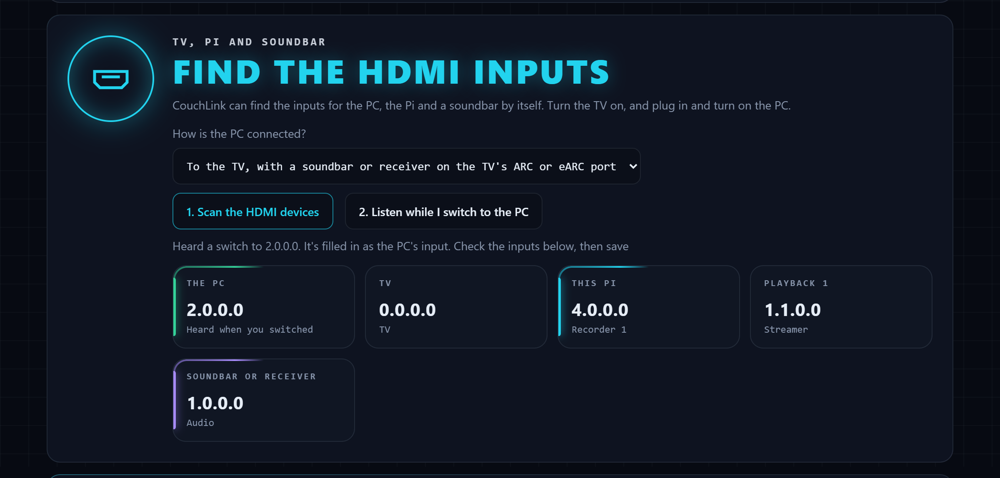

# Configuration

Finding your CEC addresses, changing settings, and every setting. The settings
page is the easy way to do both. The terminal and the config file are there as
advanced options.

## Finding your CEC addresses

Every HDMI device has a physical address that describes where it is plugged
in. A device on TV input 2 is `2.0.0.0`. A device on input 1 of a soundbar
that is itself on TV input 1 is `1.1.0.0`. CouchLink accepts either `1.1.0.0` or
the short form `11:00`.

CouchLink finds them for you. Turn the TV on, and plug in and turn on the PC.

### On the settings page

Open the [settings page](status-page-and-logs.md#settings-page) and use **Find
the HDMI inputs**:

1. Choose how the PC is connected: to the TV, to the TV with a soundbar or AV
   receiver on the ARC port, or to a soundbar or AV receiver.
2. Press **Scan the HDMI devices**. Every device that speaks CEC is listed, and
   the Pi's input and the soundbar's are filled in.
3. Press **Listen while I switch to the PC**, then switch the TV to the PC with
   the remote. The PC usually doesn't speak CEC, so this is how its input is
   found. If it hears nothing within a minute, your TV may not announce the
   switch. Type the PC's input into the field instead.
4. Check the inputs in the form, then press **Save and restart**.



The lit tiles are the inputs CouchLink will use: the PC in green, the Pi in
cyan and the soundbar in violet. The others are the rest of the devices on
the bus.

CouchLink keeps running while it does this. It uses the same connection to
the TV.

### Advanced: finding them in the terminal

```bash
sudo bash install.sh --setup-cec
```

`sudo couchlink --setup-cec` does the same. It:

1. Asks how the PC is connected: to the TV, to the TV with a soundbar or AV
   receiver on the ARC port, or to a soundbar or AV receiver.
2. Stops `couchlink.service` if it is running, since only one program can use
   the CEC adapter at a time. It starts it again at the end.
3. Asks every HDMI device who it is. This finds the Pi and the soundbar or
   receiver.
4. Listens while you switch to the PC with the remote. The PC usually doesn't
   speak CEC, so this is how its input is found. If it hears nothing, it asks
   which input number the PC is plugged into.
5. Offers to switch the TV to another input, such as a streaming box, when the
   PC goes to sleep by itself (`on_pc_sleep = "switch"`).
6. Saves `pc_addresses`, `pi_address`, `soundbar_address` and the sleep input,
   keeping the previous file as `config.toml.bak`.

### Advanced: finding them by hand

**Step 1: scan the bus.**

```bash
echo "scan" | cec-client -s -d 1
```

This lists every device that speaks CEC. Trimmed example from the tested setup:

```
device #0: TV            address: 0.0.0.0
device #1: Recorder 1    address: 4.0.0.0   (the Pi itself)
device #4: Playback 1    address: 1.1.0.0   (Google streamer)
device #5: Audio         address: 1.0.0.0   (soundbar on the TV's ARC port)
```

**Step 2: find the PC.** The PC does not speak CEC, so it will not appear in
the scan. Watch the bus while you switch to the PC's input by hand:

```bash
stdbuf -oL cec-client -d 8 | while IFS= read -r line; do
  case "$line" in *">>"*|*"<<"*) printf '%(%H:%M:%S)T %s\n' -1 "$line" ;; esac
done
```

Switch to the PC's input with the TV or soundbar remote and look for a line
that names an address, such as:

```
19:51:07 TRAFFIC: [ 20643]  >> 5f:81:12:00
```

Here the soundbar (logical address `5`) reports that its active input is now
`1.2.0.0`. That is the PC.

Stop `couchlink.service` before running either command. Only one program can
use the CEC adapter at a time.

## Changing settings

The settings are kept in `/etc/couchlink/config.toml`, which the installer
creates.

### On the settings page

The [settings page](status-page-and-logs.md#settings-page) is the easy way. It
has the PC's address, the HDMI inputs, what happens when the PC wakes or
sleeps by itself, the status page's buttons, a few timings, the API keys and
its own password. Saving checks the values, keeps the comments in the file,
and restarts CouchLink. The rest of the settings are only in the file.

### Advanced: in the terminal

To answer questions in the terminal instead:

```bash
sudo bash install.sh --setup
```

`sudo couchlink --setup` does the same. It asks for:

- the PC's IP address, and finds the PC's MAC address for you
- the SSH user
- a name for the PC on the status page
- whether the Pi is plugged into a TV. If not, it skips the next two questions
  and the CEC addresses. See [Without a TV](how-it-works.md#without-a-tv).
- what to do when the PC wakes by itself, for example from a controller
- what to do when the PC goes to sleep by itself
- whether to show the [wake and sleep buttons](status-page-and-logs.md#wake-and-sleep-buttons)
  on the status page
- a password for the [settings page](status-page-and-logs.md#settings-page)
- whether to generate an [API key](status-page-and-logs.md#api), with a name, for scripts
  and Home Assistant

Press Enter to keep the value in brackets. It keeps the comments in the file
and saves the previous version as `config.toml.bak`.

Then it offers to set up the SSH key (step 5 of
[Preparing the PC](preparing-the-pc.md)). If the PC is asleep, it offers to
wake it first, and pauses `couchlink.service` so the PC isn't put back to
sleep. If SSH fails, it says why and what to do.

### Advanced: editing the file

Every setting can go in the file itself, including the ones the settings page
doesn't have. Only root can read it, because it holds password and key
hashes, so edit it with:

```bash
sudo nano /etc/couchlink/config.toml
```

You only need to set the values for your own setup. Everything else has a
sensible default (see [Settings reference](#settings-reference) below).

Example for a PC behind the soundbar:

```toml
[pc]
pc_host = "192.168.1.50"         # the PC's IP address
pc_mac  = "aa:bb:cc:dd:ee:ff"    # MAC of the network card used for Wake-on-LAN

[cec]
pc_addresses = ["12:00"]         # soundbar input 2
pi_address = "40:00"             # TV input 4
soundbar_address = "10:00"       # TV input 1 (ARC)

[behavior]
on_pc_sleep = "switch"           # if the PC goes to sleep by itself,
pc_sleep_switch_to = "11:00"     # switch the TV to the streamer
```

Check it after every change:

```bash
sudo couchlink --check-config
```

It prints every setting with the value CouchLink will use, or a list of what is
wrong. Misspelled setting names are reported too. Then restart CouchLink to use
the change:

```bash
sudo systemctl restart couchlink
```

Section names such as `[pc]` are only there for readability. Each section may
appear only once in the file.

### Updating an older config

`install.sh --update` brings your config up to date by itself. To do it by
hand, or to see what would change first:

```bash
sudo couchlink --migrate-config --dry-run   # only show the changes
sudo couchlink --migrate-config             # make them
```

It explains every change it makes:

- Settings added in newer versions are added, with their default values and
  comments, in the right section.
- A setting name with a typo is fixed, for example `pc_adress` becomes
  `pc_addresses`.
- Settings that were renamed get their new name. Settings that CouchLink does
  not know, or that were removed, are commented out, never deleted.
- A true, false or number written in quotes is fixed, for example `"false"`
  becomes `false`.

Things only you can fill in, such as the CEC addresses, are listed at the end.
The previous version of the file is saved as `config.toml.bak`.

### API keys

Keys for scripts and Home Assistant are in their own table at the end of the
file, one per line, with only a hash of each key:

```toml
[api_keys]
home-assistant = "sha256:..."
phone = "sha256:..."
```

Generate and revoke them on the settings page, or generate one with
`sudo couchlink --new-api-key NAME`. A config from 2.6 with `api_key_hash`
keeps working, and the next update moves that key here as `default`.

## Settings reference

All settings are optional except the ones marked as required. Times are in
seconds.

### The PC

| Setting | Default | Meaning |
|---|---|---|
| `pc_host` | required | The PC's IP address or hostname. An IP with a DHCP reservation is the most reliable. |
| `pc_mac` | required | MAC address of the network card that receives Wake-on-LAN. |
| `pc_name` | unset | Name shown on the status page. If unset, CouchLink asks the PC for its hostname over SSH, then tries reverse DNS. |
| `ssh_user` | `"deck"` | The user the Pi logs in as. Correct for SteamOS. On Bazzite and others, set your own username. |
| `suspend_command` | `"sudo -n systemctl suspend"` | The command run on the PC to put it to sleep. |
| `wol_broadcast` | `"255.255.255.255"` | Where the Wake-on-LAN packet is sent. Try your subnet broadcast, such as `"192.168.1.255"`, if waking is unreliable. |
| `wol_port` | `9` | UDP port for Wake-on-LAN. |

### CEC addresses

| Setting | Default | Meaning |
|---|---|---|
| `pc_addresses` | required with a TV | List of inputs that mean the PC is on screen, such as `["12:00"]`. |
| `pi_address` | required with a TV | The input the Pi is plugged into. |
| `soundbar_address` | unset | The TV input the soundbar is on. Used to spot automatic switches and for log names. |
| `soundbar_pc_audio_address` | unset | The soundbar input carrying the PC's audio, if the PC's picture goes to the TV directly. |
| `guard_addresses` | `[]` | Extra inputs to treat as automatic switches right after a wake. |
| `pi_logical_address` | `1` | The Pi's CEC logical address. `cec-client` uses 1 by default. |
| `ignore_announcements_from` | `[]` | Logical addresses whose input announcements are ignored, such as `[5]` for a soundbar. |

### Behavior

| Setting | Default | Meaning |
|---|---|---|
| `claim_pc_input` | `true` | When the PC is selected, the Pi announces itself as the active source on the PC's behalf. This keeps the TV and soundbar on the PC and can route remote buttons to the Pi. |
| `auto_switch_on_pc_wake` | `"always"` | When the PC wakes by itself, for example from a controller: `"always"` turns the TV on and switches to it, `"if_tv_on"` only switches if the TV is already on, `"never"` leaves the TV alone. If the TV isn't switched to the PC, the PC goes back to sleep. For remote play, use a [remote session](how-it-works.md#remote-sessions) instead. |
| `on_pc_sleep` | `"nothing"` | When the PC goes to sleep by itself while on screen: `"switch"` changes to `pc_sleep_switch_to`, `"standby"` turns the TV off, `"nothing"` leaves the TV alone. |
| `pc_sleep_switch_to` | unset | The input to change to with `on_pc_sleep = "switch"`. |
| `select_soundbar_audio` | `false` | Experimental. Asks the soundbar to switch to `soundbar_pc_audio_address` when the PC comes on. |
| `watch_pc_power` | `true` | Keep an SSH session open to the PC to hear whether it is going to sleep, restarting or shutting down. Shows the right state on the status page and stops a restart from counting as sleep. See [How it works](how-it-works.md#sleep-power-off-and-restarts). |
| `verify_non_tv_standby` | `true` | When a device other than the TV sends standby (soundbars often do), ask the TV whether it is really off before acting. |
| `watch_routing_messages` | `true` | Use Routing Change and Routing Information messages. Needed for many TVs. |
| `hid_passthrough` | `true` | Forward TV remote buttons to the PC as a USB keyboard. Needs the `--with-hid` install. |
| `hidg_device` | `"/dev/hidg0"` | The USB keyboard device. |
| `dashboard_port` | `8080` | Port for the status page. `0` turns it off. |
| `use_tv` | `true` | `false` runs CouchLink without a TV, only to wake the PC for remote play and put it to sleep when asked. No CEC addresses are needed. See [How it works](how-it-works.md#without-a-tv). |
| `status_page_buttons` | `true` | Wake and sleep buttons on the status page. They need no key, so anyone who can open the page can use them. See [Status page and logs](status-page-and-logs.md#wake-and-sleep-buttons). |
| `admin_password_hash` | unset | The settings page's password, as a salted hash. Set it with `sudo couchlink --admin-password`. See [Settings page](status-page-and-logs.md#settings-page). |

### Timing

| Setting | Default | Meaning |
|---|---|---|
| `away_debounce` | `5` | How long the TV must stay off the PC's input before the PC is suspended. |
| `suspend_retry_interval` | `20` | Time between suspend attempts. |
| `max_suspend_attempts` | `4` | Suspend attempts before giving up and logging an error. |
| `wol_retry_interval` | `10` | Time between Wake-on-LAN packets. |
| `max_wol_attempts` | `6` | Wake-on-LAN packets before giving up. |
| `wake_correlation` | `45` | If the PC comes online this soon after a Wake-on-LAN packet, CouchLink treats it as its own wake. |
| `guard_window` | `15` | How long after a wake an automatic input switch gets undone. |
| `guard_delay` | `1.5` | Pause before undoing an automatic switch. |
| `max_guard_recoveries` | `2` | Automatic switches undone per wake. |
| `auto_switch_cooldown` | `30` | Minimum time between switching the TV to the PC on its own. |
| `tv_boot_timeout` | `20` | When the PC wakes with the TV off: how long to wait for the TV to report that it is on before switching it to the PC anyway. |
| `tv_boot_reclaims` | `3` | After the TV reports that it is on, how many more times to claim the PC's input. |
| `tv_boot_reclaim_interval` | `2` | Time between those claims. Input changes in this period are undone. |
| `pc_sleep_confirm` | `12` | How long the PC must stay offline before it counts as asleep. Stops Wi-Fi hiccups from triggering `on_pc_sleep`. |
| `power_poll_interval` | `60` | How often to ask the TV whether it is on. `0` asks only at startup. |
| `power_query_delays` | `[2, 8]` | When to ask the TV after another device sends standby. |
| `ping_interval` | `3` | How often to check whether the PC is reachable. |
| `tick_interval` | `1` | How often CouchLink re-checks its rules. |

### Diagnostics

| Setting | Default | Meaning |
|---|---|---|
| `raw_debug` | `true` | Log every raw CEC message. Turn off once everything works. |
| `cec_client_command` | `["cec-client", "-d", "8", "-o", "CouchLink"]` | How `cec-client` is started. `-o` sets the name the TV shows for the Pi. |

---

Back to the [Documentation](README.md) or the [README](../README.md).
