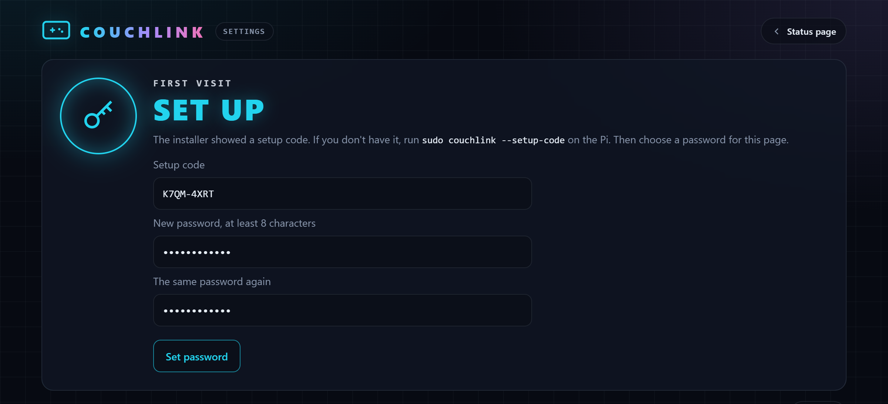
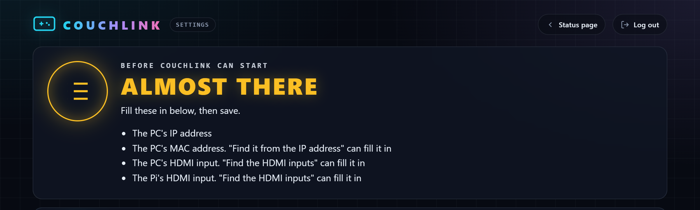
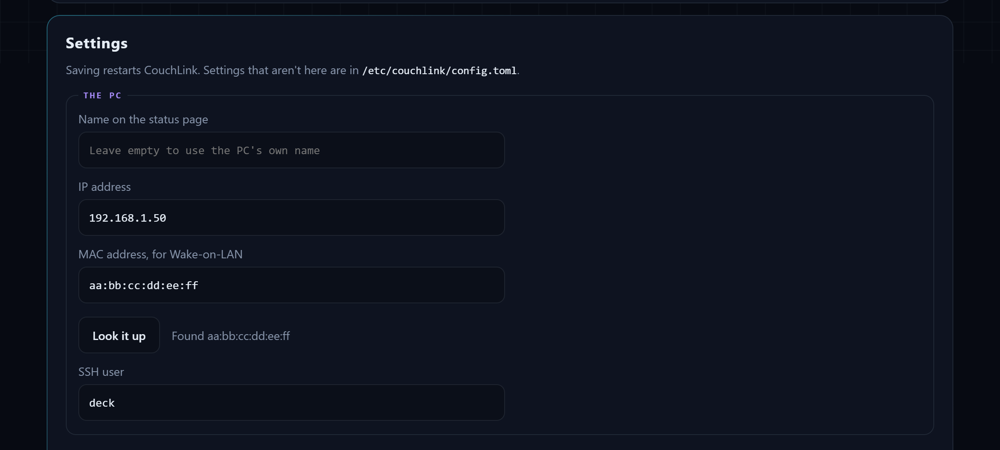

# Installation

Setting up CouchLink on the Raspberry Pi, testing it, and keeping it up to date.

## What you need

| Item | Notes |
|---|---|
| Raspberry Pi | Any model with HDMI. The optional USB keyboard needs USB gadget support (Pi Zero, Zero W, Zero 2 W, Pi 4). Developed on a Pi Zero W. |
| Raspberry Pi OS Lite | Bookworm or newer, for Python 3.11+. Use the 32-bit image on a Zero W. |
| HDMI cable | Mini HDMI for the Zero family. |
| A CEC-capable TV | CEC must be enabled in the TV's settings. Brands call it different names, such as Anynet+, Bravia Sync, SimpLink or just CEC. Not needed if you only want [remote play without a TV](how-it-works.md#without-a-tv). |
| A gaming PC | SteamOS, Bazzite or a similar distro. See [Hardware and systems](hardware.md). |
| A network | The Pi and the PC on the same LAN. |

Wired Ethernet is the most reliable way to wake the PC. See
[Preparing the PC](preparing-the-pc.md).

## Step by step

1. **Flash the SD card.** In Raspberry Pi Imager, choose Raspberry Pi OS Lite.
   In the settings, set a hostname (for example `couchlink`), a username and
   password, your Wi-Fi network and country, and turn on SSH.

2. **Plug the Pi into the TV** before powering it on, and power it from the
   PWR port. The first boot takes a few minutes.

3. **Log in to the Pi** from your computer. Open Terminal on a Mac or Linux,
   or PowerShell on Windows, and run this with the username and hostname you
   set in step 1:

   ```bash
   ssh <username>@couchlink.local
   ```

4. **Download and run the installer** on the Pi:

   ```bash
   curl -fsSLO https://raw.githubusercontent.com/blackhat840/CouchLink/main/install.sh
   sudo bash install.sh
   ```

   To also set up the USB keyboard for TV remote buttons, run
   `sudo bash install.sh --with-hid` instead, then reboot when it finishes.

   The installer downloads the latest release from GitHub, installs
   `cec-utils`, installs the program in `/usr/local/lib/couchlink` with the
   `couchlink` command, creates `/etc/couchlink/config.toml`, and starts
   `couchlink.service`. You do not need git or a GitHub account.

   At the end it asks whether to set up in the browser or in the terminal.
   Choose the browser, and it prints the settings page's address and a
   one-time setup code, such as:

   ```
   1. Open the settings page in a browser on the same network:
        http://192.168.1.20:8080/admin
      Enter this setup code, then choose a password:
        K7QM-4XRT
   ```

   If you prefer git, `git clone https://github.com/blackhat840/CouchLink.git`,
   then `cd CouchLink` and `sudo bash install.sh` installs the files from the
   clone instead.

5. **Finish the setup in the browser.** Open the settings page on your phone or
   computer, enter the setup code and choose a password.

   

   An **Almost there** list then says what CouchLink still needs:

   

   - Fill in the PC's IP address, and press **Look it up** under the MAC address
     to fill it in. The PC has to be on.

     

   - With a TV, use **Find the HDMI inputs**. Turn the TV on, choose how the PC
     is plugged in, press **Scan for devices**, then press **Listen for the PC**
     and switch the TV to the PC. See
     [Finding your CEC addresses](configuration.md#finding-your-cec-addresses).
     Without a TV, turn off "A TV is plugged into the Pi" instead.

     

   - Press **Save and restart**. CouchLink starts working.

   Until this is done, CouchLink runs only the settings page. Lost the code?
   Run `sudo couchlink --setup-code` to see it again.

6. **Prepare the PC** so the Pi can wake it and put it to sleep. See
   [Preparing the PC](preparing-the-pc.md).

7. **Give the Pi an SSH key the PC trusts**, so it can put the PC to sleep. This
   is the one step that still needs the terminal, because it asks for the
   PC's password:

   ```bash
   sudo bash install.sh --setup-ssh
   ```

   **Check SSH to the PC** on the settings page tells you whether it works.

Rather use the terminal, or write the config yourself? See
[Advanced setup](#advanced-setup).

## Advanced setup

The browser setup above is all most people need. These are for setting up
without a browser, or for settings the page doesn't have.

### In the terminal

Answer `n` when the installer asks "Set up in the browser?". It then asks for
the settings in the terminal, offers to set up the SSH key, and offers to find
the HDMI inputs. To run the same steps later:

| Command | What it does |
|---|---|
| `sudo bash install.sh --setup` | Asks for the PC's address, the SSH user, what happens when the PC wakes or sleeps by itself, the settings page's password and an API key. Then it offers to set up the SSH key. See [In the terminal](configuration.md#advanced-in-the-terminal). |
| `sudo bash install.sh --setup-cec` | Finds the HDMI inputs, with the TV on. See [Finding your CEC addresses](configuration.md#advanced-finding-them-in-the-terminal). |
| `sudo bash install.sh --setup-ssh` | Gives the Pi an SSH key the PC trusts. |

### By hand

Every setting is in `/etc/couchlink/config.toml`. To fill it in yourself:

```bash
sudo nano /etc/couchlink/config.toml
sudo couchlink --check-config
sudo systemctl restart couchlink
```

See [Editing the file](configuration.md#advanced-editing-the-file) for an
example, and the [Settings reference](configuration.md#settings-reference) for
every setting. To find the HDMI inputs without CouchLink's help, see
[Finding them by hand](configuration.md#advanced-finding-them-by-hand).

## Testing with a dry run

A dry run watches the bus and logs every decision without waking, suspending
or switching anything. It does ask the TV whether it is on, which changes
nothing.

```bash
sudo systemctl stop couchlink.service 2>/dev/null
sudo couchlink --dry-run 2>&1 | tee ~/dryrun.log
```

Open `http://couchlink.local:8080` on your phone to follow along. Then try each
of these:

| Do this | Expect in the log |
|---|---|
| Switch to the PC's input | `TV input: HDMI 1.1 -> HDMI 1.2 (PC)` and `Would send Wake-on-LAN` |
| Switch to another input | The new input, then about 5 seconds later `Would run: ssh deck@192.168.1.50 sudo -n systemctl suspend` |
| Turn the TV off | `Standby broadcast from the TV`, then a suspend |
| Turn only the soundbar off | `Standby from audio system (5)`, `TV power status: on`, and no suspend |
| Put the PC to sleep from its own menu | `PC went offline while on screen`, then about 12 seconds later the `on_pc_sleep` action |

A dry run does not send the commands that pull the TV back to the PC, so
automatic input switches will not be undone during it. That only works live.

A dry run can be useful before CouchLink acts for real, for example on a TV
that hasn't been tried with it before.

## Going live

The installer starts the service, and it begins working as soon as the setup is
saved. To follow along:

```bash
sudo journalctl -u couchlink.service -f
```

To stop it:

```bash
sudo systemctl disable --now couchlink.service
```

## Changing settings later

Use the [settings page](status-page-and-logs.md#settings-page) at
`http://<pi>:8080/admin`, or the Settings button on the status page. It
changes the common settings, finds the HDMI inputs and the PC's MAC address,
checks SSH to the PC, and manages the API keys and its own password. Saving
restarts CouchLink by itself.

### Advanced: in the terminal

| Command | What it does |
|---|---|
| `sudo bash install.sh --setup` | Asks for the settings in the terminal, all but the CEC addresses. Press Enter to keep a value. |
| `sudo bash install.sh --setup-cec` | Finds the CEC addresses in the terminal |
| `sudo bash install.sh --setup-ssh` | Gives the Pi an SSH key the PC trusts |
| `sudo couchlink --setup-code` | Shows the one-time code for setting the settings page's first password |
| `sudo couchlink --admin-password` | Sets the settings page's password |
| `sudo couchlink --new-api-key NAME` | Generates an API key for scripts and Home Assistant, such as `--new-api-key home-assistant` |
| `sudo nano /etc/couchlink/config.toml` | Edits any setting by hand. See [Configuration](configuration.md). |

After `--setup`, `--new-api-key` or editing the file, restart CouchLink to use
the change: `sudo systemctl restart couchlink`. `--setup-cec` restarts it by
itself.

## Updating

Log in to the Pi and run this in the folder that holds `install.sh`. If you
followed the steps above, that is your home folder:

```bash
sudo bash install.sh --update
```

This downloads the latest release from GitHub and installs it. Other options:

| Command | What it does |
|---|---|
| `sudo bash install.sh --release v2.3.1` | Installs that release |
| `sudo bash install.sh --release` | Lists the releases and asks which one to install |
| `bash install.sh --list-releases` | Lists the releases |
| `sudo bash install.sh --update --local` | Installs the files next to `install.sh` instead, for example after `git pull` |
| `sudo bash install.sh --update --test` | Runs the offline tests first. They check the code, not your Pi, and every release already passed them, so they are off by default. |

An update does the following, in order:

1. Downloads the release into a temporary folder and runs its installer.
2. Skips the package step.
3. Brings a copy of your config up to date for the new version and checks
   it. See [Updating an older config](configuration.md#updating-an-older-config).
4. Installs the new version.
5. Restarts the service if it is running.

If the config check fails, or the tests fail with `--test`, nothing is changed
and the installed version keeps running. Installing a release older than the installed version
asks you to confirm. If the installed version is already the latest release,
nothing happens.

Releases are downloaded from GitHub over HTTPS. They are not signed.

Up to 2.6, all of CouchLink was the one file `/usr/local/bin/couchlink`. From
2.7 the program is in `/usr/local/lib/couchlink`, and that file is a small
command that runs it. Updating from an older version moves it there by itself.

`install.sh` from version 2.2 and earlier does not download releases. Its
`--update` installs the files next to it. Run `git pull` once to get the new
installer.

Your settings are always kept. If the new version adds or changes settings,
your config is brought up to date and the previous version is saved as
`config.toml.bak`. The newest example is saved next to it, so you can see
what a new version added:

```bash
diff /etc/couchlink/config.toml /etc/couchlink/config.example.toml
```

## What gets installed

| Path | What it is |
|---|---|
| `/usr/local/lib/couchlink/` | The program |
| `/usr/local/bin/couchlink` | The `couchlink` command, which runs the program |
| `/etc/couchlink/config.toml` | Your settings, readable by root only |
| `/etc/couchlink/config.toml.lock` | Stops two saves from running at once. It's empty, and safe to leave. |
| `/etc/systemd/system/couchlink.service` | The service |
| `/usr/local/bin/couchlink-hid-gadget.sh` and `couchlink-hid.service` | The USB keyboard, with `--with-hid` only |

---

Back to the [Documentation](README.md) or the [README](../README.md).
