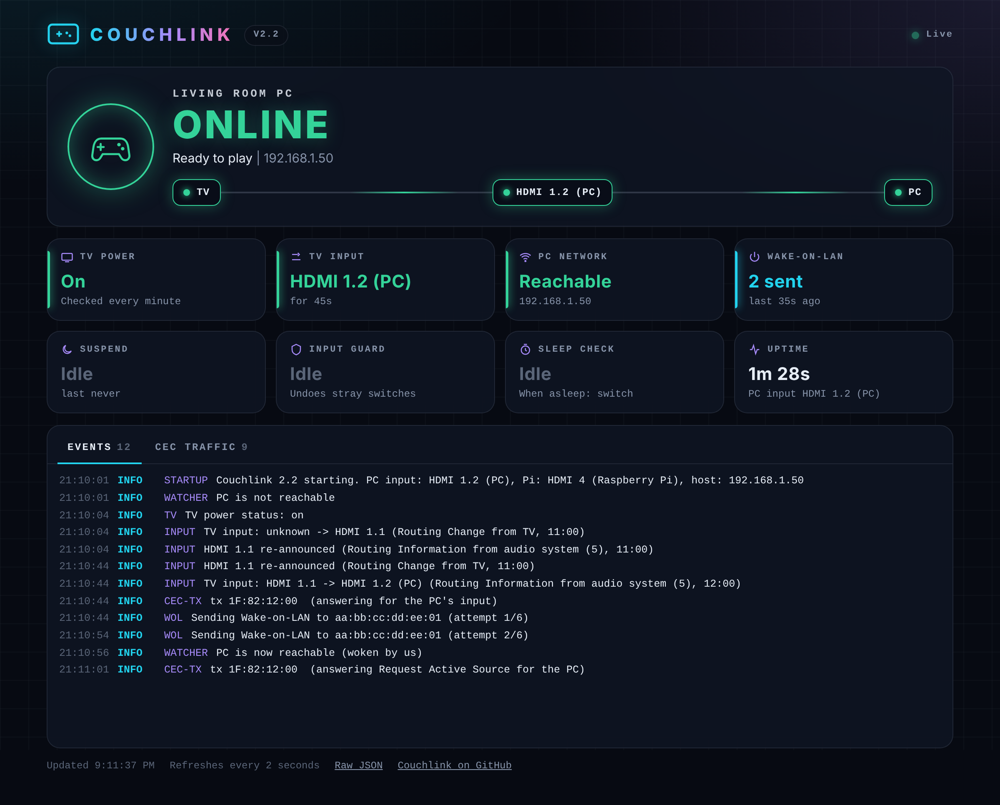

# Status page and logs

Following what CouchLink does, on the status page or in the system log.

## Status page

Open `http://<pi>:8080` on a phone or computer on the same network. It updates
every 2 seconds.



It shows:

- The PC's name and state (online, waking up, going to sleep, asleep, off,
  restarting), and the path from the TV to the PC. See
  [Sleep, power-off and restarts](how-it-works.md#sleep-power-off-and-restarts)
  for how CouchLink tells them apart. The name comes from `pc_name`, or from the PC's
  own hostname if that is not set.
- TV power and input, and how long the TV has been on that input.
- Whether the PC is on, asleep, off or restarting, and for how long. If it was
  already like that when CouchLink started, it says "for at least".
- Wake-on-LAN and suspend attempts, the input guard, the sleep check and what
  happens after it, and how long CouchLink has been running. While the PC
  restarts, the sleep check shows "On hold".
- The wake and sleep buttons, if they are turned on. See below.
- Recent events and raw CEC traffic, each in its own tab.
- Links to the raw JSON, the settings page and this repository.

[Without a TV](how-it-works.md#without-a-tv), the page shows only the PC: its
state, the buttons, Wake-on-LAN, suspend and the events. The TV's tiles, the
path and the CEC traffic tab are hidden.

If the page loses contact with CouchLink, for example because the Pi is off,
it dims everything and says when it last heard from it. It comes back by
itself when CouchLink answers again.

The browser tab's title starts with the PC's state, so you can see it from
another tab. The page loads nothing from the internet, and it works with
screen readers: the status is read out when it changes, not on every
refresh.

`http://<pi>:8080/api` returns the same information as JSON. There is no
login, so keep the page on a trusted network.

## Wake and sleep buttons

The status page can wake the PC and put it to sleep, with buttons under the
TV and PC path. They need no key or password. Anyone who can open the status
page can use them, so keep the Pi on a network you trust. To turn them off, set
`status_page_buttons = false`.

Each button shows only when it would do something:

| Button | What it does |
|---|---|
| Wake PC | Starts a [remote session](how-it-works.md#remote-sessions). The PC wakes and stays awake, and the TV is left alone. |
| Wake PC and TV | Turns the TV on, switches it to the PC and wakes the PC, like waking it with a controller. Not shown without a TV. |
| End remote session | Ends the session. If the TV is on another input, the PC is suspended after `away_debounce`. |
| Put PC to sleep | Suspends the PC over SSH and ends any session. If the TV is on the PC, `on_pc_sleep` runs as if the PC went to sleep by itself. |

In a dry run, the buttons only log what they would do.

## Settings page

The settings page, at `http://<pi>:8080/admin` or the Settings link on the
status page, changes CouchLink from a browser:

- **Settings:** the PC's address, the HDMI inputs, what happens when the PC
  wakes or sleeps by itself, the status page's buttons and a few timings.
  Saving checks the values first and saves nothing if one is wrong. It keeps
  the comments in the config file, keeps the previous version as
  `config.toml.bak`, and restarts CouchLink to use them. Other settings are
  in the config file.
- **API keys:** generate a key with a name, such as `home-assistant`, and
  revoke one without touching the others. Changes work straight away.
- **Password:** change the page's password. Other devices that are logged in
  have to log in again.

The page needs a password. Set it during `sudo bash install.sh --setup`, or
with:

```bash
sudo couchlink --admin-password
```

Logging in keeps you logged in on that device for 30 days. 5 wrong passwords
from one address lock it out for a minute. Logins, wrong passwords and every
change are logged as `[ADMIN]`. Only this page can make changes, so another
web site can't use your login.

The password is stored as a salted hash. The config file holds that hash and
the API keys' hashes, so only root can read it.

## API

The buttons use these requests. Scripts, phone shortcuts and Home Assistant
can use them too, with an API key. Give each one its own key, so you can
revoke one without touching the others. Generate keys on the
[settings page](#settings-page), or with:

```bash
sudo couchlink --new-api-key home-assistant
sudo systemctl restart couchlink
```

A key is shown once. Copy it somewhere safe, such as a password manager. Only
a hash of it is saved in the config, so it can't be shown again. Generating a
key with a name that already exists replaces that key. Keys stay until you
revoke them. The log names the key each request used, such as
`Wake PC requested from 192.168.1.20 (key home-assistant)`.

| Request | Does |
|---|---|
| `POST /api/wake` with `{"tv": false}` | Wake PC |
| `POST /api/wake` with `{"tv": true}` | Wake PC and TV |
| `POST /api/sleep` | Put PC to sleep |
| `POST /api/session/end` | End remote session |

Scripts send the key in an `Authorization` header. The body is optional, and
when there is one it must be a JSON object:

```bash
curl -X POST -H "Authorization: Bearer <key>" -d '{"tv": false}' http://<pi>:8080/api/wake
```

Each answer is JSON, such as:

```json
{"ok": true, "result": "session_started", "message": "Remote session started: keeping the PC awake without the TV until it goes to sleep or the session is ended"}
```

| `result` | Meaning |
|---|---|
| `session_started`, `session_running` | Wake PC started a remote session, or one was already running |
| `not_needed` | Wake PC did nothing, because the TV is on the PC |
| `waking_pc_and_tv` | Wake PC and TV is under way |
| `suspending` | The PC is being put to sleep |
| `already_asleep` | The PC is not reachable, so nothing was sent |
| `session_ended`, `no_session` | The session ended, or none was running |
| `no_tv` | HTTP 400. Wake PC and TV was asked for, but CouchLink runs without a TV |
| `too_soon` | HTTP 429. Only one wake, and one sleep, is accepted every 10 seconds |
| `bad_key` | HTTP 401. The key is missing or wrong |
| `locked_out` | HTTP 429. 5 wrong keys from one address lock it out for a minute |
| `actions_off` | HTTP 403. A script sent a request, but no API key has been generated yet |
| `buttons_off` | HTTP 403. The status page's buttons are off (`status_page_buttons = false`) |
| `refused` | HTTP 403. The request came from a page on another web site |

`GET /api` only reads, and needs no key. Every request is logged with the
address it came from, for example `[ACTION] Wake PC requested from 192.168.1.20`,
with `(status page)` added for the buttons. Wrong keys are logged as warnings.

The status page is told apart from scripts by headers that browsers add to
the page's own requests. Other web sites can't fake them, so a page elsewhere
can't press the buttons from your browser. A program on your network could
fake them, which is why the network is what protects the buttons.

CouchLink serves plain HTTP, so the key crosses the network unencrypted. On a
home network that is usually fine. To reach the Pi from outside the home, use a
VPN or a reverse proxy that adds HTTPS.

## Logs

Every line is `[LEVEL] [COMPONENT] message`. journald adds the time.

```bash
sudo journalctl -u couchlink.service -f                  # live
sudo journalctl -u couchlink.service -f | grep -v DEBUG  # without raw CEC traffic
sudo journalctl -u couchlink.service | grep -E "\[(INPUT|SUSPEND|WOL)\]"
```

| Component | What it logs |
|---|---|
| `INPUT` | Every input change, with the message and sender that caused it |
| `WOL` | Wake-on-LAN packets |
| `SUSPEND` | Suspend attempts and results |
| `WATCHER` | The PC becoming reachable or unreachable, and what CouchLink did about it |
| `ACTION` | Buttons and API requests, and remote sessions starting and ending |
| `ADMIN` | Logins to the settings page, wrong passwords and every change made there |
| `RECOVER` | Automatic input switches being undone |
| `TV` | Standby messages and TV power status |
| `CEC-TX` | Every command CouchLink sends, with the reason |
| `CEC` | Raw traffic, when `raw_debug` is on |
| `KEY` | Remote buttons forwarded to the PC |
| `DRY-RUN` | What would have happened |
| `CONFIG`, `STARTUP`, `CONTROL` | Setup problems and unexpected errors |

---

Back to the [Documentation](README.md) or the [README](../README.md).
